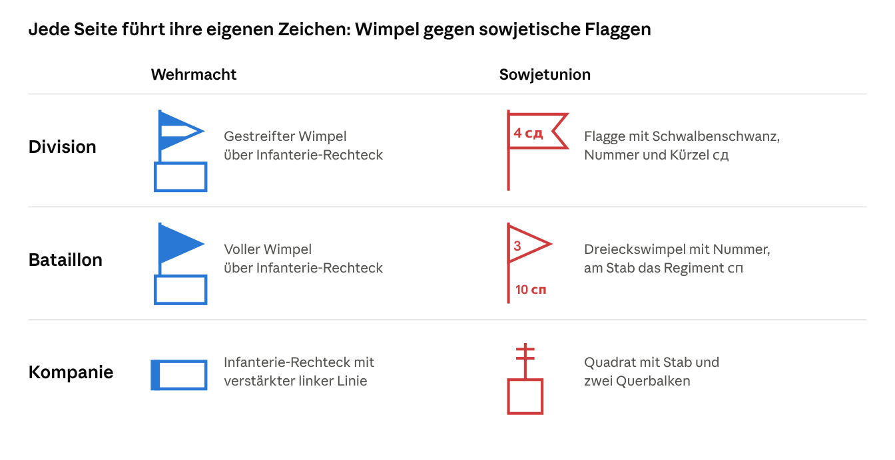

# TotalKrieg – Game Design Document (Prototyp)

Stand: 30. Oktober 2026

## Vision

TotalKrieg ist ein rundenbasiertes Operationsspiel auf einer Hexkarte: Wehrmacht gegen Sowjetunion, ein Spieler gegen die KI. Der Prototyp prüft genau eine Frage: Trägt die Schleife aus Städten halten, Manpower sammeln, Einheiten aufstellen und Städte erobern eine ganze Partie?

Die Karte liest sich wie eine Lagekarte: historische Gliederung, historische Symbole, wenig Regeln. Langfristig sollen Schlachten in taktischen Spielen ausgetragen werden, wie es die Konzeptgrafik zeigt. Das ist nicht Teil dieses Prototyps.

## MVP-Umfang

Der MVP enthält nur Infanterie, zwei Fraktionen und zwei Einkommensarten. Alles andere wartet, bis die Grundschleife nachweislich Spaß macht.

| Bereich | Im MVP | Später |
| --- | --- | --- |
| Spielfeld | Hexkarte, Objekte zufällig verteilt | Gelände, Flüsse, historische Karten |
| Fraktionen | Wehrmacht, Sowjetunion | Weitere Nationen |
| Einheiten | Infanterie: Division, Bataillon, Kompanie | Panzer, Artillerie, weitere Waffengattungen |
| Gegner | Spieler gegen KI | Mehrspieler |
| Einkommen | 1 Ressource pro Fabrik, 1 Manpower pro Stadt, je Runde | Mehr Quellen, Handel |
| Ressourcen | Werden gesammelt, haben noch keine Funktion | Munitionsaufstockung |
| Schlachten | Automatisch auf der Karte aufgelöst | Übergabe an taktische Spiele |

## Spielfeld

Das Spielfeld ist ein Hexraster, auf dem bei jedem neuen Spiel 20 Objekte zufällig verteilt werden, je 10 pro Fraktion. Als Startwert gelten 24 × 16 Hexfelder ohne Gelände. Jedes Feld hat 6 Nachbarn und hält höchstens eine Einheit pro Seite.

| Objekt | Pro Fraktion | Wirkung im MVP |
| --- | --- | --- |
| Hauptstadt | 1 | Zählt als Stadt: 1 Manpower pro Runde, stellt Einheiten auf |
| Stadt | 2 | 1 Manpower pro Runde, stellt Einheiten auf |
| Dorf | 5 | Kein Einkommen, kann erobert werden |
| Fabrik | 2 | 1 Ressource pro Runde |

Die Verteilung soll zufällig, aber fair sein:

1. Die Karte wird in eine West- und eine Osthälfte geteilt. Die Wehrmacht erhält West, die Sowjetunion Ost.
2. Jede Hauptstadt landet in der hinteren Hälfte ihrer Seite.
3. Städte, Fabriken und Dörfer folgen auf freien Feldern der eigenen Seite, mit mindestens 2 Feldern Abstand zueinander.
4. Ein Spiel wird verworfen und neu gewürfelt, wenn sich die mittlere Entfernung der Städte zur Mittellinie zwischen den Seiten um mehr als 2 Felder unterscheidet.
5. Der Zufallswert (Seed) wird gespeichert, damit sich Karten für Tests wiederholen lassen.

## Fraktionen

Beide Fraktionen spielen nach denselben Regeln und starten mit demselben Besitz; sie unterscheiden sich nur in Gliederung, Stärke und Symbolen. Der Spieler wählt eine Seite, die KI übernimmt die andere. Stichtag für alle historischen Angaben ist Sommer 1943, wie in der Konzeptgrafik.

| Merkmal | Wehrmacht | Sowjetunion |
| --- | --- | --- |
| Großverband im MVP | Infanterie-Division | Schützendivision |
| Gültiger Stand | Alte Gliederung, vor der Reform vom Oktober 1943 | Stand 10. Dezember 1942, Schtat 04/550 |
| Kartenfarbe | Blau | Rot |
| Startposition | Westhälfte | Osthälfte |

## Einheiten

Im MVP gibt es drei Einheitentypen pro Fraktion: Kompanie, Bataillon und Division. Die historischen Sollstärken stehen im Infofenster jeder Einheit, die Spielwerte sind bewusst verdichtet.

| Ebene | Wehrmacht 1943 | Mann | Sowjetunion 1943 | Mann |
| --- | --- | --- | --- | --- |
| Division | Infanterie-Division, 3 Regimenter | 16.977 | Schützendivision, 3 Regimenter | ca. 9.500 |
| Regiment (nur Info) | 3 Bataillone | 3.159 | Schützenregiment | ca. 2.500 |
| Bataillon | 3 Schützenkompanien, 1 MG-Kompanie | 838 | 3 Schützenkompanien, 1 MG-Kompanie, 1 Granatwerfer-Kompanie | 619 |
| Kompanie | Schützenkompanie | 187 | Schützenkompanie | 143 |

Wehrmacht-Werte: [TM-E 30-451, Stand 1. September 1943](https://archive.org/details/TM-E30-451), Abbildungen 3, 19 und 22; das sind US-Schätzungen der Sollstärke. Sowjetische Werte: [Bataillon und Kompanie nach Schtat 04/551](https://bayonetstrength.uk/RedArmy/RedArmyRifleBn/OrgRedRifleBn-headerpg.htm), [Division und Regiment gerundet nach ww2-weapons.com](https://ww2-weapons.com/red-army-1943-45). Die Sollstärken wurden im Krieg selten erreicht.

Die Spielwerte unten sind Startwerte für den Balancetest. Die Sowjetunion zahlt für Bataillon und Division weniger, weil ihre Verbände historisch kleiner sind.

| Einheit | Kosten Wehrmacht | Stärke Wehrmacht | Kosten Sowjetunion | Stärke Sowjetunion | Bewegung pro Runde |
| --- | --- | --- | --- | --- | --- |
| Kompanie | 1 Manpower | 4 | 1 Manpower | 3 | 3 Felder |
| Bataillon | 3 Manpower | 12 | 2 Manpower | 9 | 2 Felder |
| Division | 12 Manpower | 48 | 9 Manpower | 36 | 1 Feld |

Einheiten tragen Namen aus einer Liste realer Verbände. Diese Liste muss vor dem Bau gegen Quellen geprüft werden.

## Einheitensymbole

Beide Fraktionen haben jetzt belegte Symbole: die Wehrmacht nach H.Dv. 272 von 1941, die Sowjetunion nach dem US-Handbuch TM 30-430 von 1946. Der sowjetische Stand ist damit gut belegt, aber nicht exakt für Sommer 1943 gesichert.

**Wehrmacht:** Die Formen folgen der H.Dv. 272 von 1941. Der [Bundesarchiv-Leitfaden](https://www.bundesarchiv.de/im-archiv-recherchieren/archivgut-recherchieren/nach-themen/lagekarten-verstehen/) beschreibt den Divisionswimpel, das Infanterie-Rechteck und die Farben: Blau für deutsche Einheiten, Rot für den Feind. Bataillonswimpel und Kompanieregel stammen aus [Panzerworld](https://panzerworld.com/german-tactical-symbols-command-levels) ([Waffengattungen](https://panzerworld.com/german-tactical-symbols-branches)).

**Sowjetunion:** Die Formen stammen aus [TM 30-430, Kapitel XII, vom 15. Oktober 1946](references/TM-30-430-Kapitel-XII-1946.pdf), Seiten XII-7 und XII-8. Die Division führt eine Flagge mit Schwalbenschwanz, das Regiment eine Rechteckflagge, das Bataillon einen Dreieckswimpel. Die Beschriftung nennt Nummer und Kürzel: сд für Schützendivision, сп für Schützenregiment, сб für Schützenbataillon. Für die Kompanie nutzt der MVP das Zeichen des Kompanie-Stellungsraums, ein Quadrat mit zweifach gekreuztem Stab.

Das Handbuch warnt, dass sich sowjetische Zeichen vor allem seit 1942 stark geändert haben und selbst Dienstvorschriften uneinheitlich waren. Für den Prototyp reicht dieser Stand. Ein sowjetisches Original von 1943 bleibt ein offener Prüfpunkt.

Die Farben passen auf beiden Seiten: Deutsche Karten zeigen eigene Truppen blau und den Feind rot, sowjetische eigene Truppen rot und den Feind blau. Die Wehrmacht ist also immer blau, die Sowjetunion immer rot.

Symbole werden pro Fraktion als austauschbares Set gebaut, damit spätere Korrekturen ohne Codeänderung einziehen.

## Wirtschaft

Das Einkommen hängt allein am Besitz: Jede Fabrik bringt 1 Ressource, jede Stadt 1 Manpower pro Runde. Mit vollem Startbesitz sind das 2 Ressourcen und 3 Manpower, wenn die Hauptstadt als Stadt zählt.

- **Manpower** liegt in einem gemeinsamen Vorrat der Fraktion und wird zum Aufstellen von Einheiten ausgegeben. Reste bleiben erhalten.
- **Ressourcen** werden im MVP nur gesammelt und angezeigt. Später bezahlen sie die Munitionsaufstockung.
- **Eroberung** verschiebt das Einkommen: Wer ein Objekt hält, kassiert ab der nächsten Runde dafür.

## Aufstellung

Einheiten entstehen nur in eigenen Städten und der Hauptstadt, solange die Manpower reicht. Bei 3 Manpower pro Runde kostet eine Wehrmacht-Division 4 Runden, eine sowjetische 3 Runden Einkommen.

- Jede Stadt stellt pro Runde höchstens eine Einheit auf.
- Die Einheit erscheint auf dem Stadtfeld. Ist es besetzt, ist dort keine Aufstellung möglich.
- Eine neue Einheit kann erst in der nächsten Runde ziehen.
- Dörfer und Fabriken stellen keine Einheiten auf.
- Zum Start steht in jeder Stadt und in der Hauptstadt ein Bataillon, die Manpower beginnt bei 0.

## Rundenablauf

Eine Runde besteht aus dem Zug des Spielers und dem Zug der KI, beide mit denselben Phasen:

1. **Einkommen:** Manpower und Ressourcen werden gutgeschrieben.
2. **Aufstellung:** Neue Einheiten erscheinen in den Städten.
3. **Bewegung:** Jede Einheit zieht bis zu ihrer Reichweite. Feindliche Felder blockieren.
4. **Angriff:** Jede Einheit greift höchstens einmal ein Nachbarfeld an.
5. **Eroberung:** Wer seinen Zug auf einem gegnerischen Objekt beendet, übernimmt es.

Der Kampf ist kurz gehalten, weil er später durch taktische Spiele ersetzt werden soll:

- Beide Seiten würfeln 20 bis 40 Prozent. Jede verliert Punkte in Höhe von gegnerischer Stärke mal Wurf, aufgerundet.
- Ein Verteidiger in Stadt oder Hauptstadt zählt mit 25 Prozent mehr Stärke.
- Bei 0 Stärke ist die Einheit vernichtet. Stirbt der Verteidiger, rückt der Angreifer auf das Feld vor.
- Verluste bleiben bestehen, denn Aufstockung kommt erst mit den Ressourcen.

## KI-Gegner

Die KI spielt nach denselben Regeln wie der Spieler, sieht aber die ganze Karte, weil der MVP keinen Nebel des Krieges hat. Sie arbeitet pro Runde eine feste Prioritätenliste ab:

1. **Verteidigen:** Steht ein Gegner bis zu 2 Felder vor einer eigenen Stadt, zieht die nächste Einheit dorthin.
2. **Angreifen:** Sie greift an, wenn ihre Stärke mindestens das 1,2-Fache des Ziels beträgt.
3. **Erobern:** Übrige Einheiten ziehen zum nächsten Objekt, gewichtet nach Hauptstadt, Stadt, Fabrik, Dorf.
4. **Aufstellen:** Ist eine Stadt bedroht, stellt sie sofort Kompanien auf. Sonst spart sie auf eine Division.

## Sieg und Niederlage

Wer die gegnerische Hauptstadt erobert, gewinnt sofort. Fehlt nach 40 Runden ein solcher Sieg, gewinnt die Seite mit mehr Städten; bei Gleichstand entscheidet die Summe aller Objekte, danach ist es ein Unentschieden.

## UI

Der Prototyp übernimmt Aufbau und Stil der Konzeptgrafik, ersetzt aber die freie Karte durch das Hexraster. Das Popup zur Schlachtwahl entfällt im MVP, weil Schlachten automatisch aufgelöst werden. Die Grafik zeigt beide Fraktionen mit ihren eigenen Zeichen.

- **Obere Leiste:** Runde, Manpower, Ressourcen, Zug beenden.
- **Karte:** Hexraster, Objekte, Einheiten mit Symbol und Nummer.
- **Einheitenfenster:** Name, Stärke, Bewegung, historische Sollstärke.
- **Stadtfenster:** Einheit wählen und aufstellen, Kosten sichtbar, zu teure Einheiten gesperrt.
- **Kampfbericht:** Letzte Gefechte mit Verlusten.

## Offene Entscheidungen

Diese Punkte waren nicht vorgegeben und sind im Dokument als Annahmen gesetzt. Jeder Haken bedeutet: bestätigt oder geändert.

- [ ] Sowjetische Symbole gegen ein Original von 1943 prüfen
- [ ] Zählt die Hauptstadt als Stadt, also 3 statt 2 Manpower pro Runde?
- [ ] Welche Funktion haben Dörfer? Im MVP derzeit keine
- [ ] Stichtag Sommer 1943 für alle Gliederungen bestätigen
- [ ] Kampfregeln, Bewegung, Kosten und Stärken im Balancetest prüfen
- [ ] Startkräfte: je 1 Bataillon in jeder Stadt und in der Hauptstadt
- [ ] Sieg: Hauptstadt erobern oder Städtevergleich nach 40 Runden
- [ ] Kartengröße 24 × 16 und eine Einheit pro Feld
- [ ] Regimenter: im MVP keine spielbare Einheit, nur Info
- [ ] Liste realer Verbandsnamen je Fraktion erstellen und prüfen
- [ ] Engine und Zielplattform festlegen

## Quellen

- [TM-E 30-451, Handbook on German Military Forces, 1. September 1943](https://archive.org/details/TM-E30-451)
- [Tactical and Technical Trends Nr. 34: German Infantry Division](https://lonesentry.com/articles/ttt34/german-infantry-division.html)
- [Red Army Rifle Battalion, Schtat 04/551, 10. Dezember 1942, Gary Kennedy](https://bayonetstrength.uk/RedArmy/RedArmyRifleBn/OrgRedRifleBn-headerpg.htm)
- [Red Army 1943-45, ww2-weapons.com](https://ww2-weapons.com/red-army-1943-45)
- [Lagekarten verstehen, Bundesarchiv](https://www.bundesarchiv.de/im-archiv-recherchieren/archivgut-recherchieren/nach-themen/lagekarten-verstehen/)
- [Command Level Symbols, Panzerworld](https://panzerworld.com/german-tactical-symbols-command-levels)
- [Branch Symbols, Panzerworld](https://panzerworld.com/german-tactical-symbols-branches)
- [Russian Maps, Battle Order](https://www.battleorder.org/post/rus-maps)
- [TM 30-430, Handbook on USSR Military Forces, Kapitel XII, 15. Oktober 1946](https://digitalcommons.unl.edu/dodmilintel/29)
