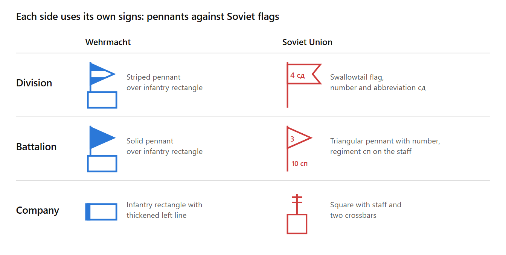
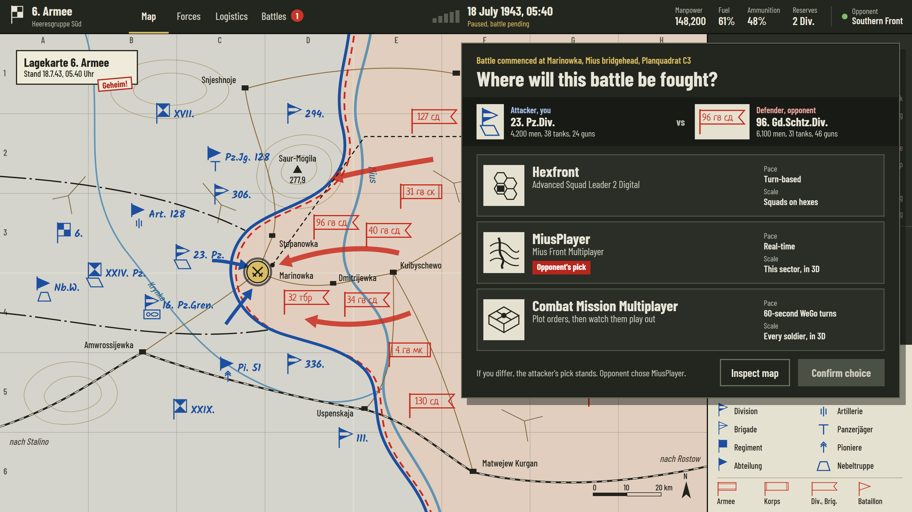

# TotalKrieg – Game Design Document (Prototype)

As of: 30 October 2026

## Vision

TotalKrieg is a turn-based operational game on a hex map: Wehrmacht against the Soviet Union, one player against the AI. The prototype tests exactly one question: does the loop of holding cities, gathering manpower, raising units and capturing cities carry a whole match?

The map reads like a situation map: historical organization, historical symbols, few rules. In the long run, battles will be fought in tactical games, as the concept art shows. That is not part of this prototype.

## MVP Scope

The MVP contains only infantry, two factions and two kinds of income. Everything else waits until the core loop has proven to be fun.

| Area | In the MVP | Later |
| --- | --- | --- |
| Playing field | Hex map, objects placed at random | Terrain, rivers, historical maps |
| Factions | Wehrmacht, Soviet Union | More nations |
| Units | Infantry: companies and battalion staffs | Divisions, tanks, artillery, other branches |
| Opponent | Player against AI | Multiplayer |
| Income | 1 resource per factory, 1 manpower per city, each round | More sources, trade |
| Resources | Gathered, no function yet | Ammunition resupply |
| Battles | Dialog on attack: automatic or as a mission in Mius-Front | More tactical games |

## Playing Field

The playing field is a hex grid on which 20 objects are placed at random for every new game, 10 per faction. The starting size is 24 × 16 hexes without terrain. Each hex has 6 neighbors and holds at most one unit per side.

| Object | Per faction | Effect in the MVP |
| --- | --- | --- |
| Capital | 1 | Counts as a city: 1 manpower per round, raises units |
| City | 2 | 1 manpower per round, raises units |
| Village | 5 | No income, can be captured |
| Factory | 2 | 1 resource per round |

The placement should be random but fair:

1. The map is split into a western and an eastern half. The Wehrmacht gets the west, the Soviet Union the east.
2. Each capital lands in the rear half of its side.
3. Cities, factories and villages follow on free hexes of their own side, at least 2 hexes apart.
4. A game is thrown out and rolled again if the mean distance of the cities to the center line differs by more than 2 hexes between the sides.
5. The random value (seed) is stored so maps can be repeated for tests.

## Factions

Both factions play by the same rules and start with the same holdings; they differ only in organization, strength and symbols. The player chooses a side, the AI takes the other. The reference date for all historical data is summer 1943, as in the concept art.

| Feature | Wehrmacht | Soviet Union |
| --- | --- | --- |
| Formation in the MVP | Infantry battalion | Rifle battalion |
| Valid status | Old organization, before the reform of October 1943 | Status of 10 December 1942, Shtat 04/550 |
| Map color | Blue | Red |
| Starting position | Western half | Eastern half |

## Units

Only companies fight on the map, battalions stand behind them as command staffs. Divisions come after the MVP. The historical establishment strengths are shown in each unit's info panel, the game values are deliberately condensed.

| Level | Wehrmacht 1943 | Men | Soviet Union 1943 | Men |
| --- | --- | --- | --- | --- |
| Battalion | 3 rifle companies, 1 MG company | 838 | 3 rifle companies, 1 MG company, 1 mortar company | 619 |
| Company | Rifle company | 187 | Rifle company | 143 |

Wehrmacht values: [TM-E 30-451, as of 1 September 1943](https://archive.org/details/TM-E30-451), figure 22; these are US estimates of the establishment strength. Soviet values: [battalion and company after Shtat 04/551](https://bayonetstrength.uk/RedArmy/RedArmyRifleBn/OrgRedRifleBn-headerpg.htm). Establishment strengths were rarely reached during the war.

The game values below are starting values for the balance test. The Soviet Union pays less for a battalion because its formations were historically smaller.

| Unit | Wehrmacht cost | Wehrmacht strength | Soviet cost | Soviet strength | Movement per round |
| --- | --- | --- | --- | --- | --- |
| Company | 1 manpower | 3 | 1 manpower | 2 | 3 hexes with a staff link, otherwise 1 hex |
| Battalion with all companies | 3 manpower | Staff 1, companies 12 | 2 manpower | Staff 1, companies 9 | Staff 2 hexes |

Units carry names from a list of real formations. This list must be checked against sources before it is built.

## Order of Battle

Each battalion consists of a command staff and its companies, all of which stand on the map individually. The companies fight, the staff leads them and gives them their movement.

| Level | Wehrmacht | Soviet Union |
| --- | --- | --- |
| Battalion | Staff, 3 rifle companies of 3 each, 1 MG company of 3 | Staff, 3 rifle companies of 2 each, 1 MG company of 2, 1 mortar company of 1 |

- **Companies:** Each company has a callsign and a leader, an officer or NCO. Both are invented. German callsigns stay in German as names.
- **Staff link:** A company is linked if its staff stands at most 4 hexes away. It then moves 3 hexes, without a link only 1 hex. If the staff moves up, the link applies again at once.
- **Staff:** It moves 2 hexes, never attacks and captures nothing. It has strength 1 and can be attacked. If it falls, its companies lose their link.
- **Affiliation:** The order of battle shows the battalion, companies, positions and losses. A dashed line connects staff and companies on the map, a red dot marks companies without a link.
- **Independent companies:** Companies raised on their own belong to no battalion and therefore always move only 1 hex.

## Unit Symbols

Both factions now have sourced symbols: the Wehrmacht after H.Dv. 272 of 1941, the Soviet Union after the US handbook TM 30-430 of 1946. The Soviet status is thus well documented, but not exactly confirmed for summer 1943.

**Wehrmacht:** The shapes follow H.Dv. 272 of 1941. The [Bundesarchiv guide](https://www.bundesarchiv.de/im-archiv-recherchieren/archivgut-recherchieren/nach-themen/lagekarten-verstehen/) describes the division pennant, the infantry rectangle and the colors: blue for German units, red for the enemy. The battalion pennant and the company rule come from [Panzerworld](https://panzerworld.com/german-tactical-symbols-command-levels) ([branches](https://panzerworld.com/german-tactical-symbols-branches)).

**Soviet Union:** The shapes come from [TM 30-430, chapter XII, of 15 October 1946](references/TM-30-430-Kapitel-XII-1946.pdf), pages XII-7 and XII-8. The division carries a swallowtail flag, the regiment a rectangular flag, the battalion a triangular pennant. The label gives number and abbreviation: сд for rifle division, сп for rifle regiment, сб for rifle battalion. The game writes these in English: RR for the rifle regiment, Rfl, MG and Mtr for its companies. For the company, the MVP uses the sign of the company position area, a square with a double-crossed staff.

The handbook warns that Soviet signs changed a lot, especially since 1942, and that even service regulations were inconsistent. This status is enough for the prototype. A Soviet original from 1943 remains an open check.

The colors fit on both sides: German maps show own troops in blue and the enemy in red, Soviet maps own troops in red and the enemy in blue. So the Wehrmacht is always blue, the Soviet Union always red.

Symbols are built as an exchangeable set per faction, so later corrections need no code change.

## Economy

Income depends only on holdings: each factory yields 1 resource, each city 1 manpower per round. With the full starting holdings that is 2 resources and 3 manpower, if the capital counts as a city.

- **Manpower** sits in a common pool of the faction and is spent on raising units. Leftovers are kept.
- **Resources** are only gathered and shown in the MVP. Later they pay for ammunition resupply.
- **Capture** shifts income: whoever holds an object collects for it from the next round on.

## Raising Units

Units appear only in own cities and the capital, as long as the manpower lasts. A battalion appears with its staff on the city hex and its companies on the free hexes next to it.

- Each city raises at most one unit per round.
- The unit appears on the city hex. If it is occupied, nothing can be raised there.
- A new unit can only move or attack from the next round on.
- Villages and factories raise no units.
- At the start every city and the capital hold a battalion with all its companies, manpower starts at 0.

## Turn Sequence

A round consists of the player's turn and the AI's turn, without fixed phases. Income comes at the start of a turn, then the side acts in any order until it ends its turn.

- **Raise:** Cities raise units at any time during the own turn.
- **Move:** Each unit may move as far as its movement allows per round, also in several steps. Enemy hexes block.
- **Attack:** A company that moves onto an enemy-held hex starts a battle. The step onto the enemy counts. It advances to the hex next to the enemy.
- **Capture:** A company that ends its turn on an enemy object takes it over.

Several companies take part in a battle on both sides:

- **Attacker:** The attacking company and all own companies next to the target hex that have not fought this round. All attackers are done for the round afterwards.
- **Defender:** The unit on the target hex and all its companies next to the target hex.

When the player attacks, a dialog asks how the battle is resolved: automatically or as a mission in Mius-Front. Hexfront, MiusPlayer and Combat Mission are listed as tactical layers in the dialog, but are still open. Cancel leaves everything unchanged. AI attacks are resolved automatically.

The automatic resolution is kept short because tactical games will supplement it later:

- Both sides roll 20 to 40 percent. Each loses points equal to the opposing total strength times the roll, rounded up.
- A defender in a city or capital counts with 25 percent more strength.
- Losses always hit the strongest unit involved first. At 0 strength it is destroyed. If the unit on the target hex falls, the attacking company advances there.
- The beaten side is the one that lost the larger share of its strength. With equal shares the battle ends in a draw.
- Losses stay, because replacements only come with resources.

After every battle with a winner, the lead unit of the beaten side flees if it survived:

- **Direction:** It moves one hex to a free neighboring hex farther from the enemy. That costs no movement.
- **Choice:** A player unit flees to the hex the player clicks. Nothing else is possible until then. AI units flee at once.
- **AI turn:** Beaten player units stay put until the AI has ended its turn. The player then chooses. Until then the AI can attack them again.
- **Advance:** If the defender flees, the attacker's lead company advances onto the vacated hex.
- **No way out:** Without a free hex the unit stays and the winner does not advance.

## Mius-Front Integration

The player can fight an attack in Graviteam Tactics: Mius-Front. For this, TotalKrieg uses MiusMissionMaker to create a mission with exactly the companies of the battle, so 2 against 3 companies stay 2 against 3 there too.

| TotalKrieg | Mius-Front | Wehrmacht unit | Soviet unit |
| --- | --- | --- | --- |
| Rifle company | Company HQ and 3 rifle platoons | `wer_mibn_1141_comcoy`, `wer_mibn_1141_plat` | `ra_rbn_1242_comcoy`, `ra_rbn_1242_plat2` |
| MG company | Company HQ and 1 MG platoon | `wer_mibn_1141_mg_com`, `wer_mibn_1141_mg_plat1` | `ra_rbn_1242_mg_com`, `ra_rbn_1242_mg_plat` |
| Mortar company | Company HQ and 1 mortar platoon | does not exist | `ra_rbn_1242_mt82_com`, `ra_rbn_1242_mt82_plat` |
| Battalion staff | Battalion HQ | `wer_mibn_1141_combat` | `ra_rbn_1242_combat` |

- **Participants:** The mission contains exactly the companies of the battle, see Turn Sequence. The order of battle and the dialog show what each company becomes.
- **Strength:** A weakened rifle company fields proportionally fewer rifle platoons, rounded up. MG and mortar companies keep their platoon.
- **Staffs:** A staff comes along if a company in the battle is linked to it or if it is attacked itself.
- **Limit:** MiusMissionMaker allows 15 platoons per formation type. Larger battles are scaled down proportionally on both sides. Combat platoons go before company HQs, staffs drop out first.
- **Map:** The mission uses a fixed map: `tr06` for the Wehrmacht, `tr02` for the Soviet Union. The player attacks. A defender in a city is dug in, otherwise it stands in the open in line.
- **Sequence:** The dialog first shows the battle line-up. Only "Start Mius-Front" builds the mission and opens the game.
- **Result:** At the end of the battle, Mius-Front writes a result file and the outcome to its log. TotalKrieg checks once per second and shows the outcome and the list of losses as soon as they are there. "Apply result" books the losses.
- **List of losses:** It shows each company's strength before and after, below it every platoon with its lost squads and the condition of the others. Each side has a total of lost squads. Numbers of men are not in the result file.
- **Losses:** Each platoon belongs to a company or a staff. The company keeps the share of its strength that its platoons kept on average. A company with survivors keeps at least 1 strength. Companies left out when scaling down share the average of their side. A staff whose platoon was lost entirely disappears from the map.
- **Outcome:** On victory or defeat the beaten side flees as described above, on a draw everyone stays. Result code 3 counts as a draw, which has not yet been confirmed in a real battle.
- **Fallback:** As long as there is no result, Victory, Draw and Defeat are available to choose. Fixed losses then apply:

| Result | Attacker loss | Defender loss |
| --- | --- | --- |
| Victory | 25 percent | All involved destroyed, the attacker advances |
| Draw | 30 percent | 30 percent |
| Defeat | 50 percent | 20 percent |

## AI Opponent

The AI plays by the same rules as the player, but sees the whole map, because the MVP has no fog of war. It works through a fixed list of priorities each round:

1. **Defend:** If an enemy stands up to 2 hexes from an own city, the nearest unit moves there.
2. **Attack:** It attacks if its strength is at least 1.2 times that of the target.
3. **Capture:** Remaining companies move to the next object, weighted by capital, city, factory, village.
4. **Lead:** Staffs move to the center of their companies.
5. **Raise:** If a city is threatened, it raises companies at once. Otherwise it saves for a battalion.

## Victory and Defeat

Whoever captures the enemy capital wins at once. Without such a victory after 40 rounds, the side with more cities wins; on a tie the sum of all objects decides, after that it is a draw.

## UI

The prototype takes the layout and style of the concept art, but replaces the free map with the hex grid. The battle choice popup appears on every player attack. The art shows both factions with their own signs.

- **Top bar:** Round, manpower, resources, end turn.
- **Map:** Hex grid, objects, units with symbol and number.
- **Unit panel:** Name, strength, movement, staff link, historical establishment strength.
- **City panel:** Choose and raise a unit, costs visible, units that are too expensive locked.
- **Combat log:** Latest battles with losses.

## Open Decisions

These points were not given and are set as assumptions in this document. Each check means: confirmed or changed.

- [ ] Check Soviet symbols against an original from 1943
- [ ] Does the capital count as a city, so 3 instead of 2 manpower per round?
- [ ] What function do villages have? None in the MVP so far
- [ ] Confirm the reference date of summer 1943 for all organizations
- [ ] Check combat rules, movement, costs and strengths in a balance test. AI against AI, 400 matches: Wehrmacht 368, Soviet Union 26, draws 6
- [ ] May every unit move per turn, or only one? Currently every unit
- [ ] Should the player also choose the resolver for AI attacks? Currently automatic
- [ ] Which levels of the result code exist in Mius-Front, and what does the score in the result file mean?
- [ ] More maps for the Mius-Front missions, such as villages and defensive situations
- [ ] Starting forces: 1 battalion with all companies in every city and in the capital
- [ ] Victory: capture the capital or compare cities after 40 rounds
- [ ] Map size 24 × 16 and one unit per hex
- [ ] Does the player move staffs or do they follow automatically? Currently the player does
- [ ] Should independent companies be able to join a battalion?
- [ ] Create and check a list of real formation names per faction
- [ ] Decide the target platform. The engine is Go with Ebitengine, tested on Windows

## Sources

- [TM-E 30-451, Handbook on German Military Forces, 1 September 1943](https://archive.org/details/TM-E30-451)
- [Tactical and Technical Trends No. 34: German Infantry Division](https://lonesentry.com/articles/ttt34/german-infantry-division.html)
- [Red Army Rifle Battalion, Shtat 04/551, 10 December 1942, Gary Kennedy](https://bayonetstrength.uk/RedArmy/RedArmyRifleBn/OrgRedRifleBn-headerpg.htm)
- [Red Army 1943-45, ww2-weapons.com](https://ww2-weapons.com/red-army-1943-45)
- [Lagekarten verstehen, Bundesarchiv](https://www.bundesarchiv.de/im-archiv-recherchieren/archivgut-recherchieren/nach-themen/lagekarten-verstehen/)
- [Command Level Symbols, Panzerworld](https://panzerworld.com/german-tactical-symbols-command-levels)
- [Branch Symbols, Panzerworld](https://panzerworld.com/german-tactical-symbols-branches)
- [Russian Maps, Battle Order](https://www.battleorder.org/post/rus-maps)
- [TM 30-430, Handbook on USSR Military Forces, chapter XII, 15 October 1946](https://digitalcommons.unl.edu/dodmilintel/29)
